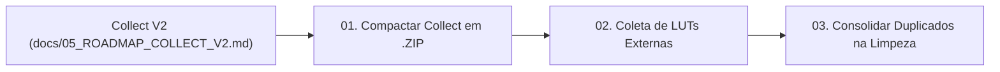

# Roadmap de Expansão Enxuta (Backlog Aprovado)

Este diretório contém o planejamento técnico detalhado dos **3 únicos recursos extras aprovados** após a análise de UX e performance do **TidyFlow**.

Todos os 3 respeitam duas regras inegociáveis:
1. **Zero poluição no Painel Principal (`360×440 px`):** Nenhum botão novo será adicionado à tela principal.
2. **Zero peso durante a edição:** Nenhuma rotina roda em background enquanto o usuário edita na timeline.

---

## 1. Mapa dos 3 Recursos Aprovados

| Ordem | Recurso | Arquivo Detalhado | Onde Vive na UI | Hosts |
| :-: | :--- | :--- | :--- | :---: |
| **01** | **Compactação Automática em `.ZIP` no Collect** | [`01_COMPACTACAO_ZIP_COLLECT.md`](01_COMPACTACAO_ZIP_COLLECT.md) | 1 checkbox na janela `com.tidyflow.collect` | AE + PPro |
| **02** | **Coleta e Relink de LUTs Externas (`.cube` / `.look`)** | [`02_COLETA_LUTS_EXTERNAS.md`](02_COLETA_LUTS_EXTERNAS.md) | Automático (ou 1 checkbox) na janela `com.tidyflow.collect` | AE + PPro |
| **03** | **Consolidação de Mídias Duplicadas (*Deduplicate*)** | [`03_CONSOLIDAR_DUPLICADOS.md`](03_CONSOLIDAR_DUPLICADOS.md) | Embutido na ação existente **Verificar Comps / Limpeza** | AE + PPro |

---

## 2. Sequência Recomendada de Entrega

---

## 3. Registro de Recursos Descartados (Proteção contra *Feature Creep*)

Para referência futura, os seguintes itens foram analisados e **oficialmente descartados** do escopo para não deixar o plugin pesado ou confuso:
- ❌ **Auto-Organize ao Importar:** Descartado por travar a thread síncrona do ExtendScript em importações grandes, corromper a pilha de `Ctrl+Z` (*Undo*) do editor e conflitar com a triagem de áudio por timeline (ESP) do Premiere.
- ❌ **Batch Renamer no Painel:** Descartado por exigir múltiplos inputs na interface principal; a necessidade real já é atendida pela opção *"Renomear mídias no disco para o nome dos clipes"* (Fase 2 do Collect V2).
- ❌ **Smart Relinker de Offline:** Descartado por duplicar o *Link Media* nativo do Premiere Pro e o relink em cascata nativo do After Effects.
